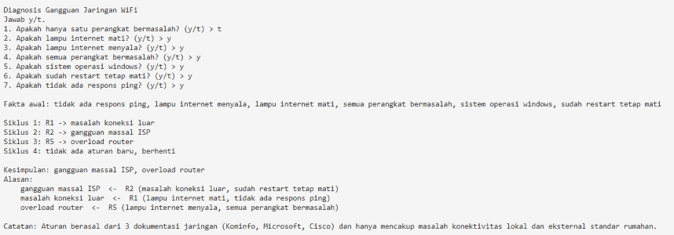
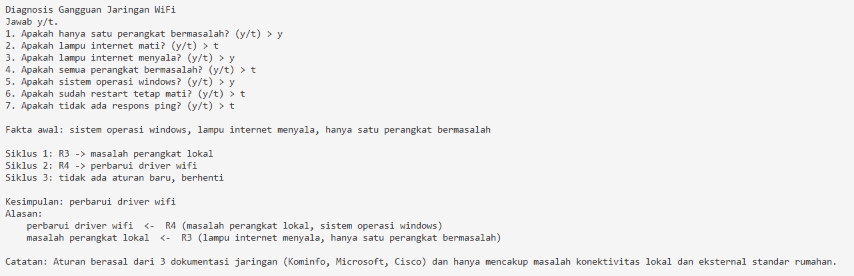
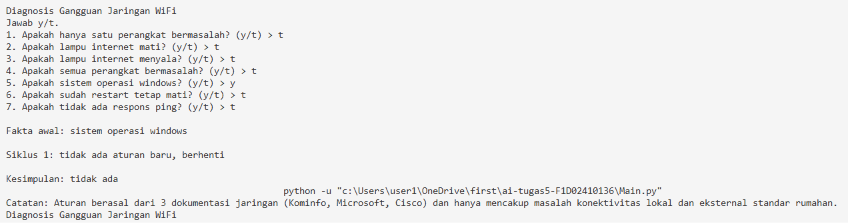

# Tugas 5 - Sistem Pakar Diagnosis Gangguan Jaringan WiFi

## 1. Identifikasi Mahasiswa
* **Nama:** Waritsa Wulan Ramadanis
* **NIM:** F1D02410136
* **Nama Repositori:** ai-tugas5-F1D02410136

---

## 2. Topik dan Cara Menjalankan Program
* **Topik:** Diagnosis Gangguan Jaringan WiFi Rumahan (Konektivitas Lokal dan Eksternal).
* **Bahasa Pemrograman:** Python 3
* **Berkas Utama:** `main.py` dan `kb_wifi.json`.

### Cara Menjalankan Program:
1. Pastikan perangkat Anda sudah terpasang Python 3.
2. Letakkan berkas `main.py` dan `kb_wifi.json` dalam satu folder yang sama.
3. Buka Terminal atau Command Prompt, lalu masuk ke direktori folder tersebut.
4. Jalankan perintah berikut:
   ```bash
   python main.py
   ```
5. Jawab setiap pertanyaan gejala jaringan yang muncul dengan mengetik `y` (Ya) atau `t` (Tidak), lalu tekan `Enter`.

---

## 3. Daftar Sumber dan Tabel Aturan

### Daftar Sumber Referensi (Metadata):
1. **S1:** *Gangguan Akses Internet, Kemenkominfo Minta Telkom Segera Lakukan Pemulihan*, Direktorat Jenderal Aplikasi Informatika - Kementerian Komunikasi dan Informatika RI (Kominfo), URL: https://kominfo.go.id, Diakses pada: 10 November 2026.
2. **S2:** *Memperbaiki Masalah Koneksi Wi-Fi di Windows*, Microsoft Support, URL: https://microsoft.com, Diakses pada: 10 November 2026.
3. **S3:** *Troubleshoot Wireless Client Connectivity Issues*, Cisco Systems Inc. Technical Support & Documentation, URL: https://cisco.com, Diakses pada: 10 November 2026.

### Tabel Aturan IF-THEN:

| Aturan | IF | Mode | THEN | Sumber |
| :---: | :--- | :---: | :--- | :---: |
| **R1** | lampu internet mati, tidak ada respons ping | atau | masalah koneksi luar | S1 |
| **R2** | masalah koneksi luar, sudah restart tetap mati | dan | gangguan massal ISP | S1 |
| **R3** | lampu internet menyala, hanya satu perangkat bermasalah | dan | masalah perangkat lokal | S2 |
| **R4** | masalah perangkat lokal, sistem operasi windows | dan | perbarui driver wifi | S2 |
| **R5** | lampu internet menyala, semua perangkat bermasalah | dan | overload router | S3 |

*Catatan: Aturan **R1** menghasilkan fakta "masalah koneksi luar" yang kemudian digunakan sebagai prasyarat logika pada aturan **R2** sehingga membentuk pergerakan rantai aturan (chaining).*

---

## 4. Metode Inferensi dan Alasan Pemilihan
Metode inferensi yang diimplementasikan dalam sistem pakar ini adalah **Forward Chaining (FC)** atau Pelacakan Maju.

### Alasan Pemilihan:
* **Pendekatan Berbasis Data (*Data-Driven*):** Kasus troubleshooting jaringan sangat cocok diselesaikan dengan Forward Chaining karena prosesnya dimulai dari pengumpulan gejala-gejala teknis yang tampak terlebih dahulu (seperti kondisi lampu modem atau respons ping), untuk kemudian ditarik maju hingga menemukan kesimpulan diagnosis akhir.
* **Efisiensi Pertanyaan:** Metode ini mempermudah program dalam menyusun daftar pertanyaan terstruktur kepada pengguna guna mengeliminasi aturan-aturan yang tidak relevan secara dinamis sejak awal siklus berjalan.

---

## 5. Kasus Uji dan Screenshot

### Kasus Uji 1: Diagnosis Gangguan Kombinasi (Menghasilkan Kesimpulan)
* **Jawaban "ya" dari user:** `tidak ada respons ping`, `lampu internet menyala`, `lampu internet mati`, `semua perangkat bermasalah`, `sistem operasi windows`, `sudah restart tetap mati`
* **Hasil Kesimpulan:** gangguan massal ISP, overload router
* **Tampilan Screenshot:**
  

### Kasus Uji 2: Diagnosis Pembaruan Driver Wifi (Menghasilkan Kesimpulan)
* **Jawaban "ya" dari user:** `hanya satu perangkat bermasalah`, `lampu internet menyala`, `sistem operasi windows`
* **Hasil Kesimpulan:** perbarui driver wifi
* **Tampilan Screenshot:**
  

### Kasus Uji 3: Skenario Gejala Tidak Sesuai Aturan (Kasus Negatif / Tidak Ada Kesimpulan)
* **Jawaban "ya" dari user:** `sistem operasi windows` (saja)
* **Hasil Kesimpulan:** tidak ada
* **Tampilan Screenshot:**
  

---

## 6. Batas Keberlakuan Pengetahuan
Pengetahuan sistem pakar ini dirancang satu paragraf berdasarkan rangkuman dokumentasi resmi jaringan milik Kominfo, Microsoft, dan Cisco. Batas cakupan masalah sistem ini hanya berlaku untuk menangani gangguan konektivitas lokal nirkabel dan eksternal skala kecil pada jaringan internet rumah standar. Seluruh hasil keluaran diagnosis beserta pohon pelacakan alasan (*backward trace*) yang ditampilkan oleh program **bersifat sebagai rekomendasi atau saran troubleshooting awal bagi pengguna mandiri, bukan merupakan keputusan teknis mutlak yang menggantikan regulasi atau penanganan langsung oleh teknisi penyedia jasa internet (ISP).**

---

## 7. Penggunaan Alat Bantu AI
* **Alat AI yang Digunakan:** Claude.
* **Tujuan Penggunaan:** Digunakan untuk membantu menstrukturisasi basis pengetahuan jaringan ke dalam skema file JSON, serta merapikan penyusunan komponen tabel dokumentasi markdown ini agar sesuai dengan instruksi pengerjaan tugas.

